# 🚗 Geely EX2 — bộ app điều khiển xe

**3 app, mỗi cái chạy trên một thiết bị: màn hình xe · điện thoại · máy tính.**

💬 Nhóm Zalo hỗ trợ / trao đổi: **[zalo.me/g/knl7dndglibpuzclc4vg](https://zalo.me/g/knl7dndglibpuzclc4vg)**

  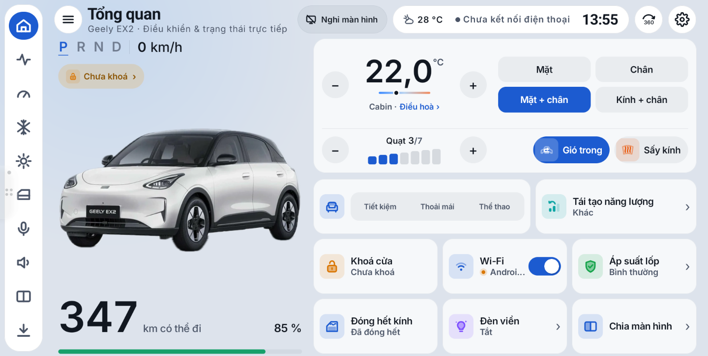 
  Car Connect trên màn hình giữa Geely EX2 (1920×1080): thanh biểu tượng bên trái, điều hoà và các tiện ích xe ngay trên màn Tổng quan

---

## 🌟 Vì sao nên dùng bộ app này?

> **Biến Geely EX2 thành chiếc xe bạn điều khiển được — từ ghế lái, từ điện thoại, từ máy tính.**

- 🎙️ **Nói tiếng Việt là xe nghe** — gọi "Hi Geely" rồi ra lệnh; hơn 180 câu lệnh điều khiển,
  nhận dạng **ngay trên xe** (không cần mạng). Xe đọc lại kết quả bằng giọng nói.
- 🧭 **Một màn hình, mọi thứ trong 1 chạm** — Tổng quan gom điều hoà, chế độ lái, khoá cửa,
  Wi-Fi, áp suất lốp, đóng kính, đèn viền và chia màn hình; thanh biểu tượng bên trái mở từng màn chi tiết.
- 🪟 **Truy cập nhanh nổi trên mọi ứng dụng** — đang mở bản đồ hay video vẫn chỉnh được điều hoà,
  chế độ lái, âm lượng, độ sáng mà không phải quay về app.
- 📱 **Điều khiển xe từ điện thoại** — xem pin, quãng đường còn lại, khoá xe, mở cốp, đóng/mở
  kính, chỉnh điều hoà qua Bluetooth, Wi-Fi hoặc Cloud 4G khi xe đang thức (ACC / nổ máy).
- 🧊 **Điều hoà theo chương trình** — "Làm mát nhanh", "Làm ấm nhanh", "Thông gió mạnh" chạy
  một chuỗi bước (nhiệt độ → quạt → gió trong → chờ) chỉ với một nút "Chạy".
- 📲 **Cài app cho xe không cần máy tính, không cần ADB** — kho "Cài nhanh" chia nhóm Bản đồ,
  Video & nhạc, Trình duyệt, Tiện ích xe; chọn nhiều app rồi cài một lượt, cập nhật tất cả một lần.
- 🔒 **An toàn cho xe theo thiết kế** — app **không đụng tới phân vùng `/system`**, không
  cần root, không unlock bootloader: cài vào là dùng, gỡ ra là xe về nguyên trạng.
- 🔑 **Cần mã kích hoạt để dùng — bộ app này không miễn phí.** Tải file ở dưới rồi
  kích hoạt bằng **mã + số điện thoại** do quản trị viên cấp (1 mã = 1 người).
  Liên hệ nhóm Zalo bên trên để được cấp mã. Trong app không có quảng cáo.

---

## 📚 Mục lục

1. [Vì sao nên dùng bộ app này?](#-vì-sao-nên-dùng-bộ-app-này)
2. [Các app trong kho này](#-các-app-trong-kho-này)
3. [Giao diện & Tính năng từng app](#-giao-diện--tính-năng-từng-app)
   - [🚗 Car Connect (Màn hình xe)](#-car-connect--app-trên-màn-hình-xe)
   - [📱 Phone Connect (Điện thoại)](#-phone-connect--app-điện-thoại-android--ios)
   - [💻 PCConnect (Máy tính)](#-pcconnect--app-máy-tính-macos--windows)
4. [Sơ đồ kết nối](#-sơ-đồ-kết-nối)
5. [Thao tác bị chặn khi xe đang chạy](#️-thao-tác-bị-chặn-khi-xe-đang-chạy)
6. [Cách cài](#-cách-cài)
7. [Kích hoạt mở thêm gì?](#-kích-hoạt-mở-thêm-gì)
8. [Báo lỗi / góp ý](#-báo-lỗi--góp-ý)

---

## 📦 Các app trong kho này

| File | Cài ở đâu | Trạng thái | Chức năng tóm tắt |
|---|---|---|---|
| `CarConnect.apk` | 🚗 Màn hình xe Geely EX2 (Android 9) | ✅ Chính thức | App chạy trên xe: điều hoà, chế độ lái, cửa & kính, đèn viền, âm thanh, giọng nói tiếng Việt, chia đôi màn hình, cài app + cập nhật |
| `PhoneConnect.apk` | 📱 Điện thoại Android | ✅ Chính thức | Xem trạng thái + điều khiển xe (Bluetooth / Wi-Fi / Cloud 4G), điều hoà, cốp & kính, nhật ký hoạt động |
| `PhoneConnect.ipa` | 📱 iPhone | ✅ Chính thức | Bản iOS của Phone Connect — cùng giao diện và tính năng như bản Android |
| `PCConnect(MacOS).dmg` | 💻 Máy Mac (Apple Silicon & Intel) | ✅ Chính thức | App quản lý trên máy tính: cứu hộ ADB, quét tìm IP xe, cài app XAPK/APKs/OBB cho xe |
| `PCConnect(Windows).exe` | 💻 Máy Windows (x64) | ✅ Chính thức | Bản Windows của PCConnect — cùng chức năng như bản macOS |

---

## ✨ Giao diện & Tính năng từng app

### 🚗 Car Connect — app trên màn hình xe

Giao diện thiết kế riêng cho màn hình giữa 1920×1080: nút lớn, chữ dễ đọc khi liếc, mục đang bật/đang
chọn tô đặc màu xanh. Có giao diện **ban ngày và ban đêm** theo giờ của xe.
Thanh biểu tượng bên trái mở 10 màn: Tổng quan · Trạng thái · Lái xe · Điều hoà · Đèn viền · Cửa & cửa sổ ·
Giọng nói · Âm thanh · Ứng dụng · Cài nhanh; nút bánh răng góc trên mở Cài đặt.

#### 1. Tổng quan & Trạng thái

  
  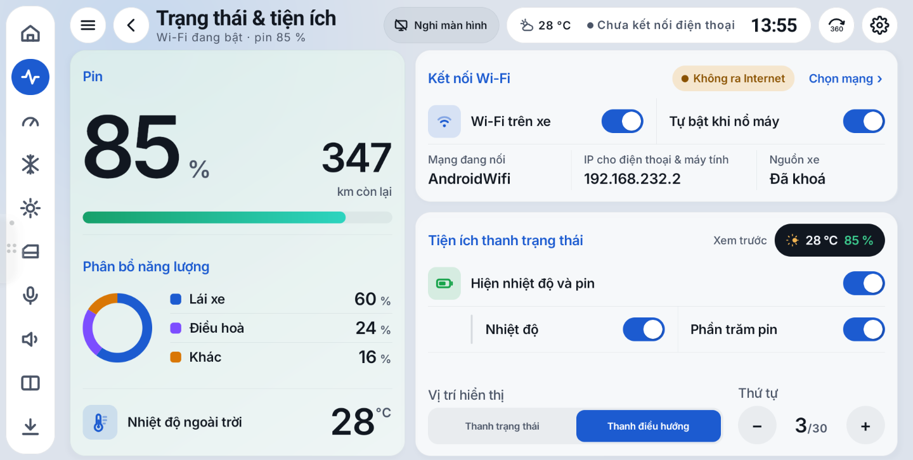 
  (Trái) Tổng quan: số đang gài, tốc độ, quãng đường còn đi được, điều hoà và các ô tiện ích · (Phải) Trạng thái: pin, phân bổ năng lượng, Wi-Fi và tiện ích thanh trạng thái

- **Tổng quan**: số P/R/N/D, tốc độ, km còn đi được + % pin; chỉnh nhiệt độ, quạt, hướng gió, gió trong, sấy kính
  ngay tại chỗ; ô nhanh cho chế độ lái, tái tạo năng lượng, khoá cửa, Wi-Fi, áp suất lốp, đóng hết kính, đèn viền, chia màn hình.
- **Thanh trên cùng**: nhiệt độ ngoài trời, trạng thái kết nối điện thoại, đồng hồ, nút **Nghỉ màn hình**, nút mở camera 360.
- **Trạng thái & tiện ích**: % pin + km còn lại, phân bổ năng lượng (lái xe / điều hoà / khác), nhiệt độ ngoài trời.
- **Wi-Fi trên xe**: bật/tắt, tự bật khi nổ máy, xem mạng đang nối và **IP cho điện thoại & máy tính**, chọn mạng.
- **Tiện ích thanh trạng thái**: hiện nhiệt độ và % pin lên thanh trạng thái hoặc thanh điều hướng của xe, chọn thứ tự hiển thị (1–30), có ô xem trước.

---

#### 2. Lái xe & Điều hoà

  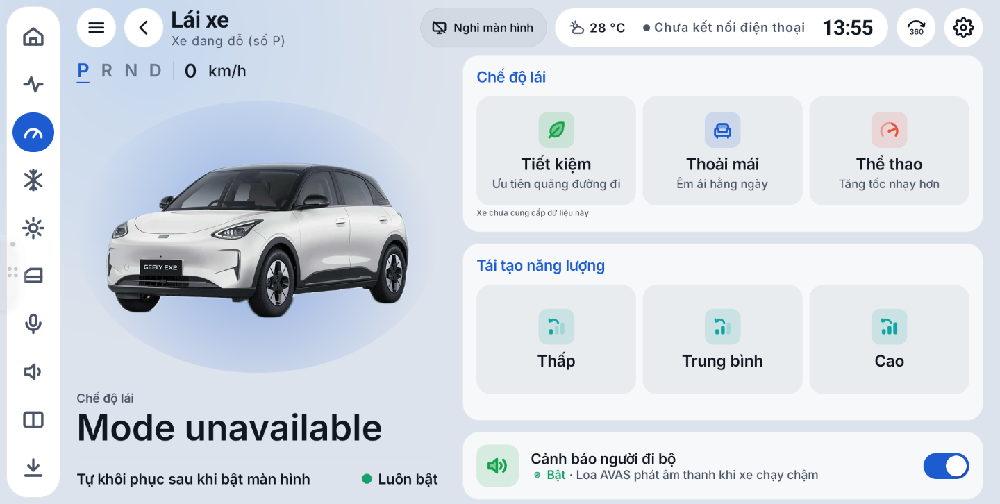
  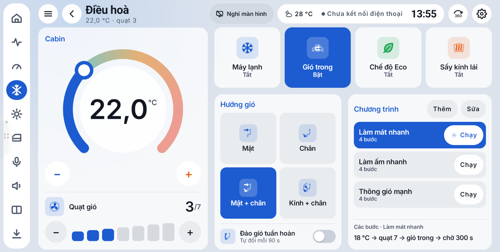 
  (Trái) Chế độ lái, tái tạo năng lượng và cảnh báo người đi bộ · (Phải) Điều hoà: vòng nhiệt độ, quạt 7 mức, hướng gió và chương trình nhiều bước

- **Chế độ lái**: Tiết kiệm · Thoải mái · Thể thao (mỗi chế độ một màu riêng).
- **Tái tạo năng lượng**: Thấp · Trung bình · Cao. App **tự khôi phục** chế độ lái và mức tái tạo sau khi bật màn hình.
- **Cảnh báo người đi bộ (AVAS)**: bật/tắt loa phát âm ra ngoài khi xe chạy chậm.
- **Điều hoà**: nhiệt độ bước 0,5 °C, quạt 7 mức, Máy lạnh, Gió trong, Chế độ Eco, Sấy kính lái,
  4 hướng gió (Mặt · Chân · Mặt + chân · Kính + chân) và **Đảo gió tuần hoàn** tự đổi mỗi 90 giây.
- **Chương trình điều hoà**: Làm mát nhanh, Làm ấm nhanh, Thông gió mạnh — mỗi chương trình là chuỗi bước
  (ví dụ 18 °C → quạt 7 → gió trong → chờ 300 s); thêm và sửa chương trình ngay trên màn.

---

#### 3. Đèn viền & Cửa, cửa sổ

  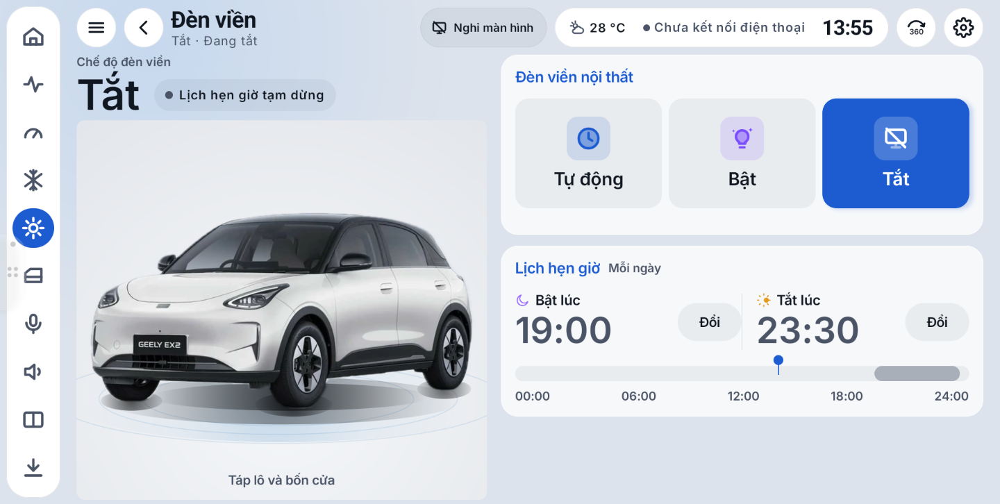
  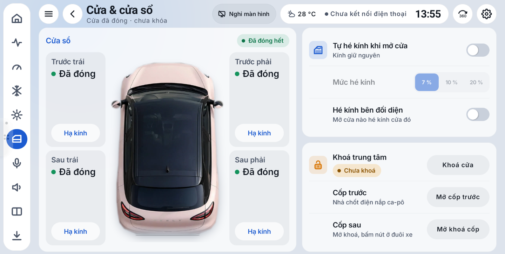 
  (Trái) Đèn viền nội thất với lịch hẹn giờ mỗi ngày · (Phải) Cửa sổ 4 góc nhìn từ nóc xe, khoá trung tâm và cốp

- **Đèn viền nội thất** (táp-lô và bốn cửa): Tự động · Bật · Tắt; **lịch hẹn giờ mỗi ngày** (ví dụ bật 19:00, tắt 23:30), xem trên thước 24 giờ.
- **Cửa sổ**: trạng thái từng kính (Trước trái · Trước phải · Sau trái · Sau phải) và nút **Hạ kính** cho từng cửa.
- **Tự hé kính khi mở cửa**: chọn mức 7 % · 10 % · 20 %; tuỳ chọn **hé kính bên đối diện**.
- **Khoá trung tâm**, **mở cốp trước** (nhả chốt ca-pô) và **mở khoá cốp sau**.

---

#### 4. Giọng nói & Âm thanh

  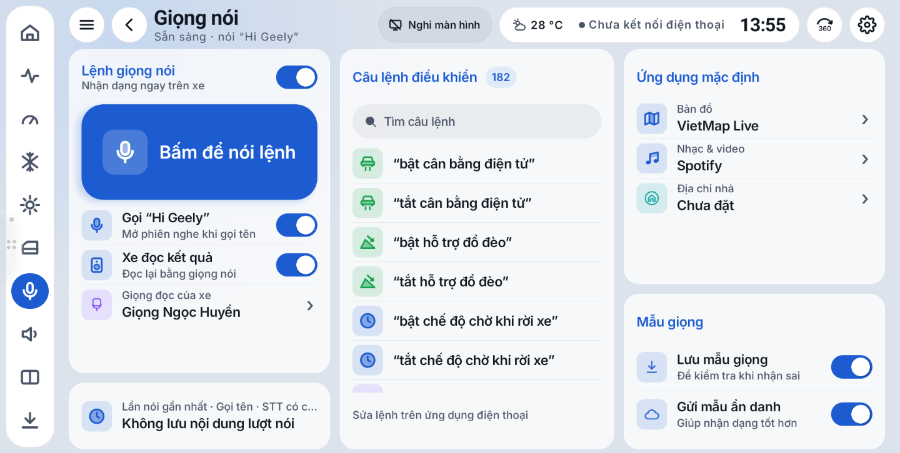
  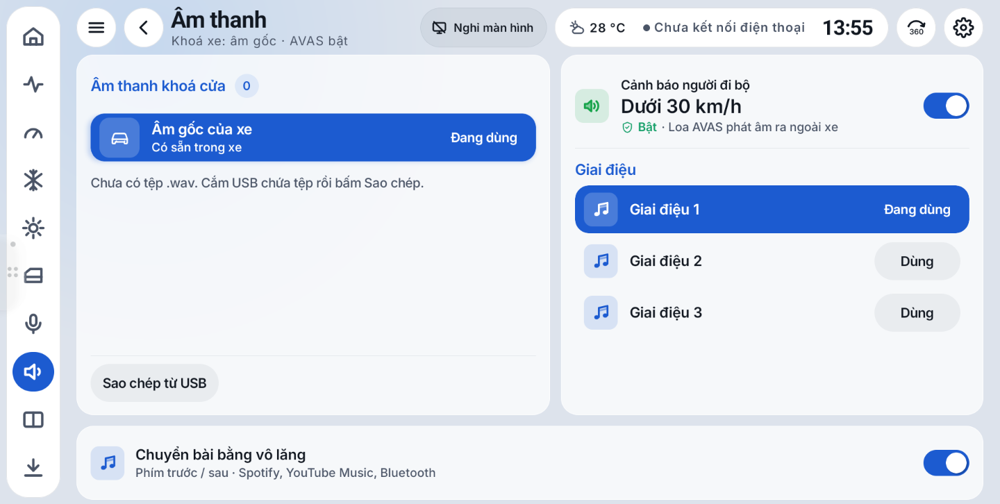 
  (Trái) Trợ lý giọng nói tiếng Việt với danh sách câu lệnh tìm được · (Phải) Âm thanh khoá cửa, giai điệu AVAS và chuyển bài bằng vô lăng

- **Lệnh giọng nói nhận dạng ngay trên xe**: gọi **"Hi Geely"** hoặc bấm nút lớn "Bấm để nói lệnh"; xe đọc lại kết quả bằng giọng nói, chọn được giọng đọc.
- **Danh sách câu lệnh** (hơn 180 câu) có ô tìm kiếm; sửa câu lệnh trên ứng dụng điện thoại.
- **Ứng dụng mặc định cho lệnh thoại**: bản đồ (ví dụ VietMap Live), nhạc & video (ví dụ Spotify), địa chỉ nhà.
- **Mẫu giọng**: tuỳ chọn lưu mẫu giọng để kiểm tra khi nhận sai và gửi mẫu ẩn danh để cải thiện nhận dạng (bạn tự bật/tắt).
- **Âm thanh khoá cửa**: dùng âm gốc của xe hoặc chép tệp `.wav` từ USB.
- **AVAS**: chọn 1 trong 3 giai điệu cảnh báo người đi bộ (phát dưới 30 km/h).
- **Chuyển bài bằng vô lăng**: phím trước/sau cho Spotify, YouTube Music, Bluetooth.

---

#### 5. Ứng dụng, chia đôi màn hình & Cài nhanh

  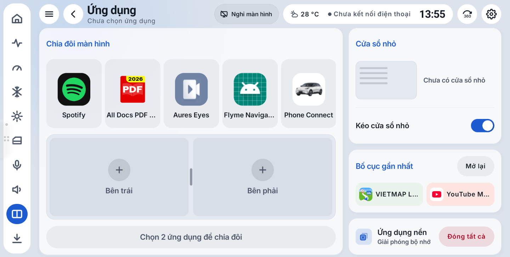
  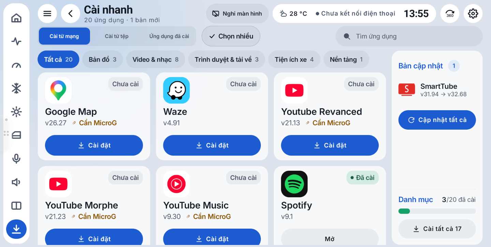 
  (Trái) Chọn 2 ứng dụng để chia đôi, cửa sổ nhỏ, bố cục gần nhất · (Phải) Cài nhanh: danh mục theo nhóm, cài nhiều app, cập nhật tất cả

- **Chia đôi màn hình**: chọn app Bên trái / Bên phải, xem trước khung chia; **Mở lại bố cục gần nhất** một chạm (ví dụ VietMap Live + YouTube).
- **Cửa sổ nhỏ** kéo được và **Đóng tất cả ứng dụng nền** để giải phóng bộ nhớ.
- **Cài nhanh**: cài từ mạng, cài từ tệp, xem ứng dụng đã cài; lọc theo nhóm (Bản đồ · Video & nhạc · Trình duyệt & tải về · Tiện ích xe · Nền tảng) và tìm theo tên.
- **Chọn nhiều** rồi cài một lượt, hoặc **Cài tất cả**; app cần MicroG được báo trước và MicroG được cài trước.
- **Bản cập nhật**: thấy ngay app nào có bản mới (ví dụ SmartTube v31.94 → v32.68), bấm **Cập nhật tất cả**.

---

#### 6. Truy cập nhanh nổi & Điều khiển chia đôi

  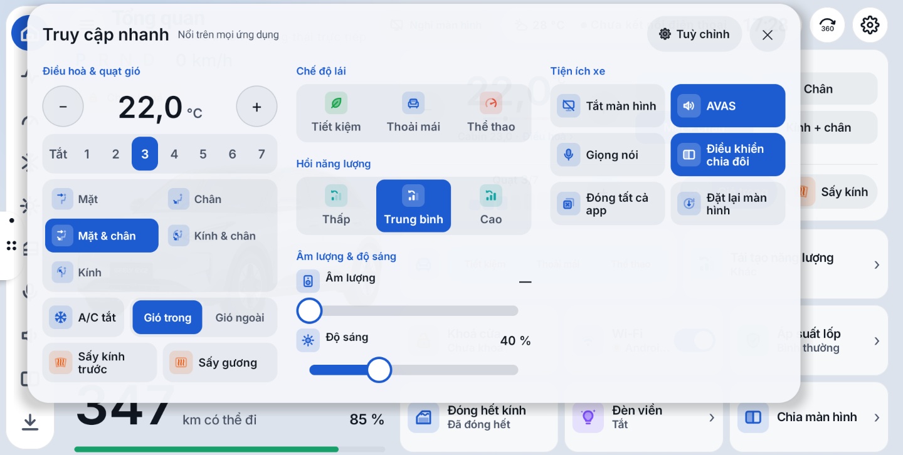 
  Bảng "Truy cập nhanh" nổi trên mọi ứng dụng: điều hoà & quạt gió · chế độ lái, hồi năng lượng, âm lượng & độ sáng · tiện ích xe

  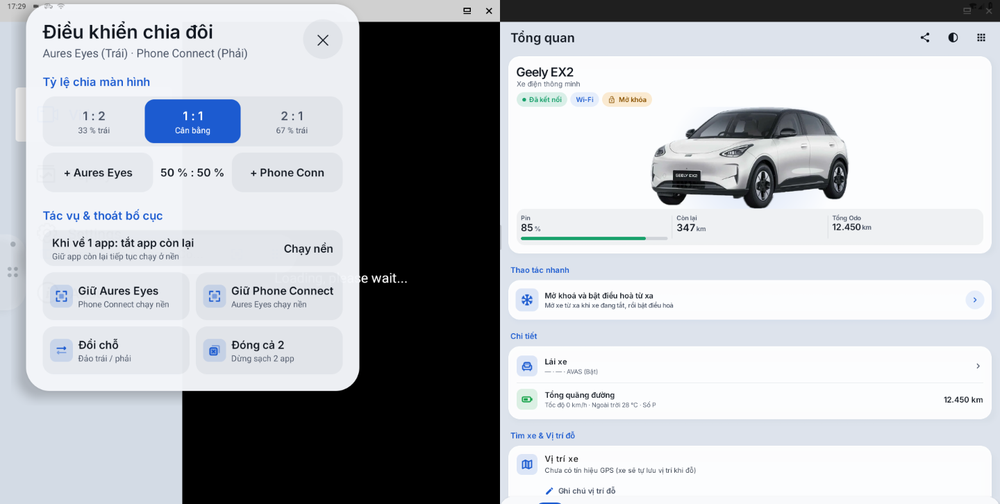
  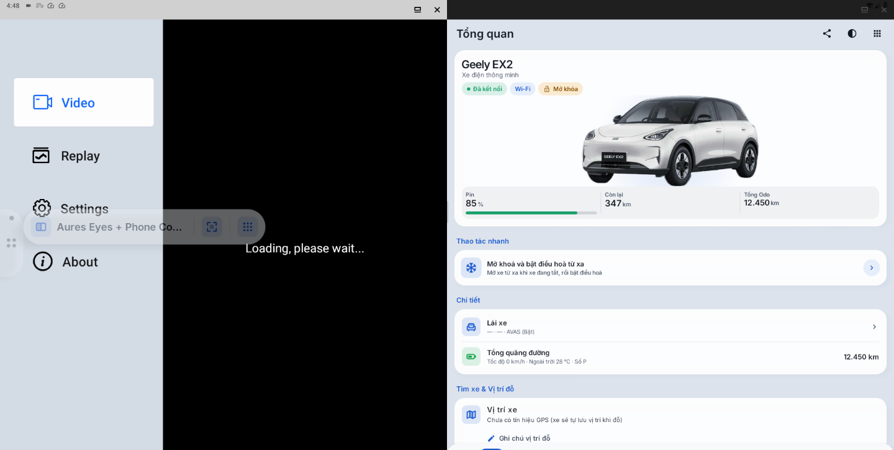 
  (Trái) Bảng "Điều khiển chia đôi": đổi tỷ lệ, đổi chỗ, đóng cả 2 app · (Phải) Thanh chia đôi thu gọn nằm trên 2 ứng dụng đang chạy

- **Truy cập nhanh** (tab mờ ghim mép trái màn hình): nhiệt độ, quạt Tắt/1–7, hướng gió, A/C, Gió trong/Gió ngoài,
  sấy kính trước, sấy gương; chế độ lái, mức hồi năng lượng; thanh **âm lượng** và **độ sáng**;
  tiện ích Tắt màn hình, AVAS, Giọng nói, Điều khiển chia đôi, Đóng tất cả app, Đặt lại màn hình. Nút **Tuỳ chỉnh** để chọn mục hiện.
- **Điều khiển chia đôi**: tỷ lệ 1:2 · 1:1 · 2:1, đổi app từng bên, **Đổi chỗ** trái/phải, **Đóng cả 2**,
  giữ một app và cho app còn lại chạy nền. Thu gọn thành thanh nhỏ nằm trên 2 ứng dụng.

---

#### 7. Cài đặt

  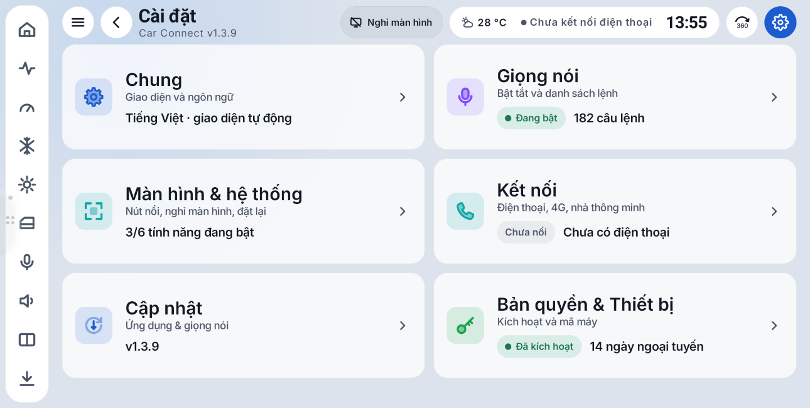 
  Cài đặt gom thành 6 nhóm, mỗi nhóm hiện trạng thái ngay trên thẻ

- **Chung** (ngôn ngữ, giao diện tự động) · **Giọng nói** (bật/tắt, danh sách lệnh) · **Màn hình & hệ thống** (nút nổi, nghỉ màn hình, đặt lại)
  · **Kết nối** (điện thoại, 4G, nhà thông minh) · **Cập nhật** (ứng dụng & giọng nói) · **Bản quyền & Thiết bị** (kích hoạt, mã máy).

---

### 📱 Phone Connect — app điện thoại (Android · iOS)

Cùng phong cách với app trên xe, có giao diện Tự động · Sáng · Tối. Năm tab: **Tổng quan · Điều khiển · Điều hoà · Nhật ký · Cài đặt**.

  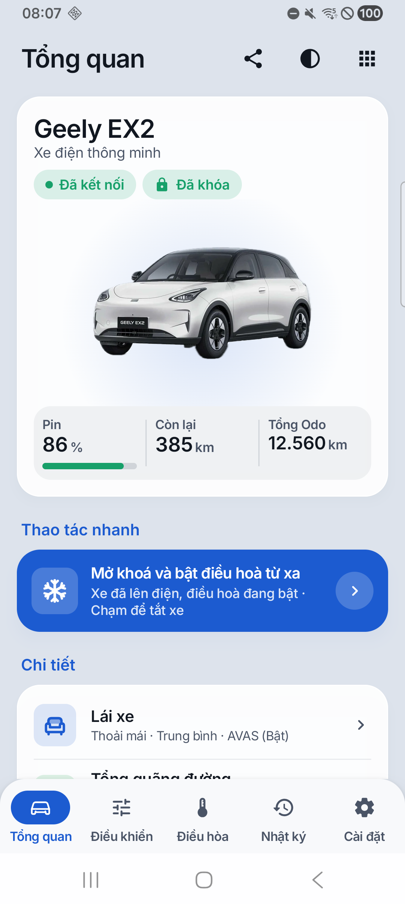
  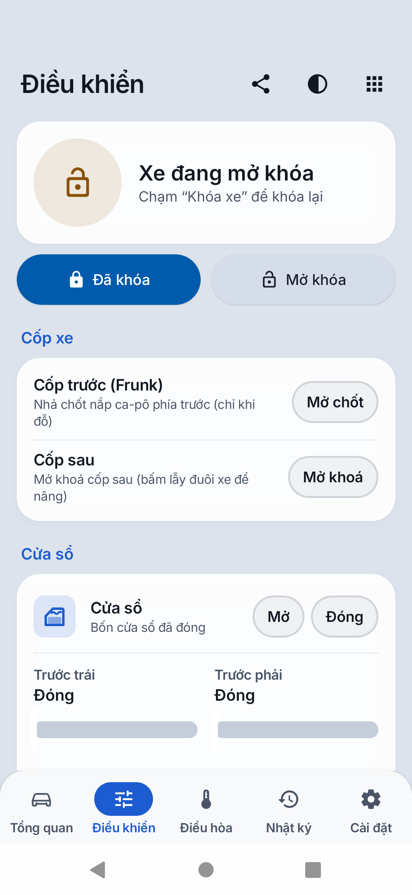
  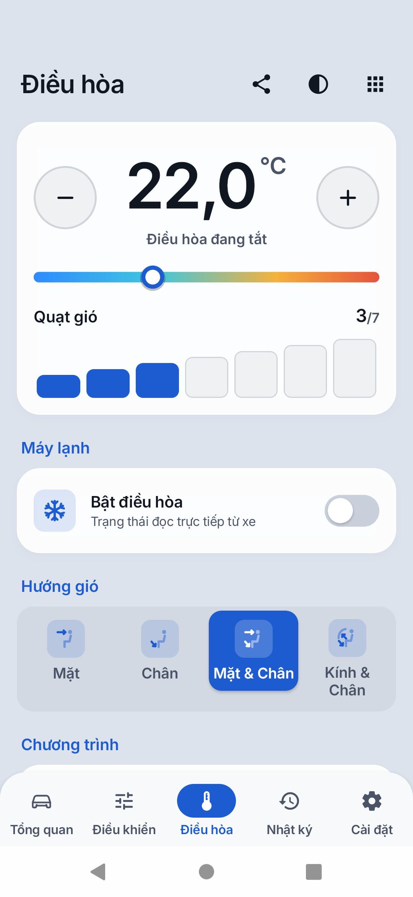
  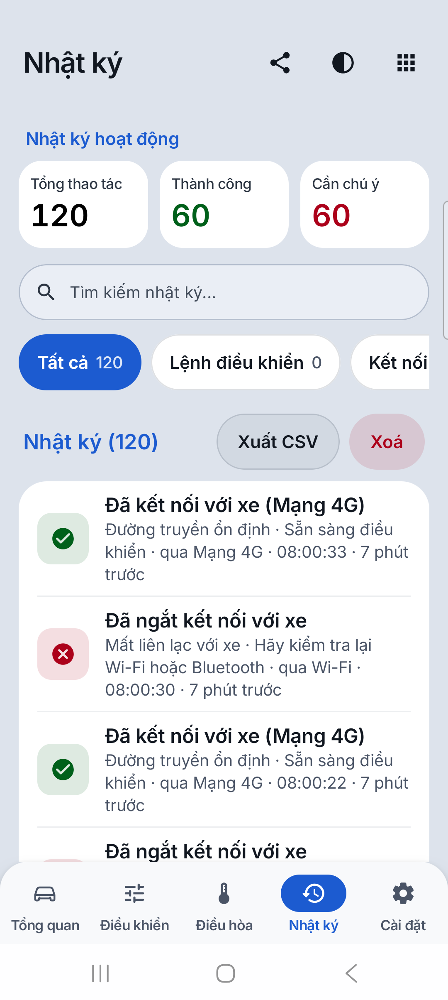
  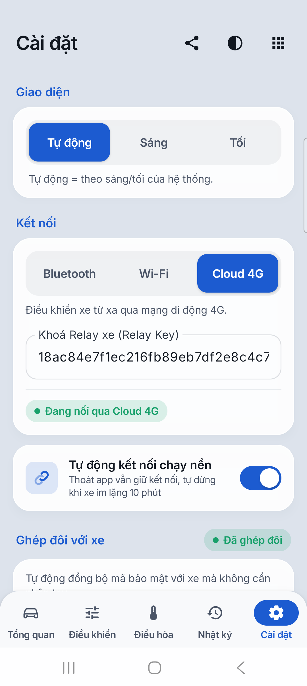 
  Tổng quan · Điều khiển · Điều hoà · Nhật ký · Cài đặt

- **Tổng quan**: trạng thái kết nối, kênh đang dùng, khoá cửa; pin %, km còn lại, tổng ODO; lối tắt
  **Mở khoá và bật điều hoà từ xa** (xe lên điện và tự bật điều hoà, luôn hỏi lại trước khi đề nổ); chi tiết lái xe, tổng quãng đường, vị trí đỗ xe.
- **Điều khiển**: trạng thái khoá và nút **Khoá xe** (mở khoá vẫn dùng chìa khoá); mở chốt **cốp trước**, mở khoá **cốp sau**;
  mở/đóng cửa sổ và xem từng kính.
- **Điều hoà**: nhiệt độ, quạt 7 mức, bật/tắt máy lạnh (trạng thái đọc trực tiếp từ xe), 4 hướng gió, chạy chương trình điều hoà.
- **Nhật ký**: tổng thao tác, thành công, cần chú ý; tìm kiếm, lọc theo nhóm (Lệnh điều khiển, Kết nối…), **Xuất CSV**, xoá nhật ký.
- **Cài đặt**: giao diện Tự động/Sáng/Tối; kênh kết nối **Bluetooth · Wi-Fi · Cloud 4G**; **tự động kết nối chạy nền**
  (tự dừng khi xe im lặng 10 phút); **Quét tìm xe** trong cùng mạng Wi-Fi hoặc hotspot.
- **Trang con** (nút lưới góc trên): Lái xe · Ứng dụng · Hành trình · Lịch & chương trình điều hoà · **Kho ứng dụng**
  (cài app lên xe không cần máy tính) · Bảo trì · Cài đặt xe · Câu lệnh giọng nói · Nhạc & Hình nền xe.

> [!IMPORTANT]
> **💡 ĐIỀU KIỆN ĐIỀU KHIỂN TỪ ĐIỆN THOẠI — XE PHẢI ĐANG THỨC:**
> Phone Connect nói chuyện trực tiếp với Car Connect trên màn hình xe. Vì vậy **xe cần đang thức (bật ACC, nổ máy hoặc
> màn hình xe đang bật)** để nhận lệnh. Khi xe tắt máy, khoá kín và ngủ sâu, đầu xe ngắt điện nên không nhận được lệnh.

---

### 💻 PCConnect — app máy tính (macOS / Windows)

- **Quét tìm xe (Network Scan)**: quét dải mạng /24 để tìm IP màn hình xe — chỉ dùng để tìm xe, PCConnect không gửi lệnh điều khiển xe.
- **Cứu hộ qua ADB**: hướng dẫn mở khoá, tự tính mã kỹ thuật theo giờ, kiểm tra kết nối — adb nhúng sẵn trong app.
- **Tab ⚡ Cài nhanh**: bấm 1 nút là tải + cài (SmartTube, Waze, VietMap…) — hỗ trợ link GitHub / Google Drive / tải trực tiếp.
- **Cài từ file / folder**: kéo-thả APK, XAPK, APKs, tự đưa thư mục OBB vào đúng `/sdcard/Android/obb/`.
- **Quản lý package trên xe**: ẩn/hiện app (không mất dữ liệu), gỡ cài đặt app.
- **Công cụ thiết bị**: chia màn hình 2 app, gỡ kẹt cửa sổ nhỏ (PIP), chạy lệnh shell.

---

## 🔌 Sơ đồ kết nối

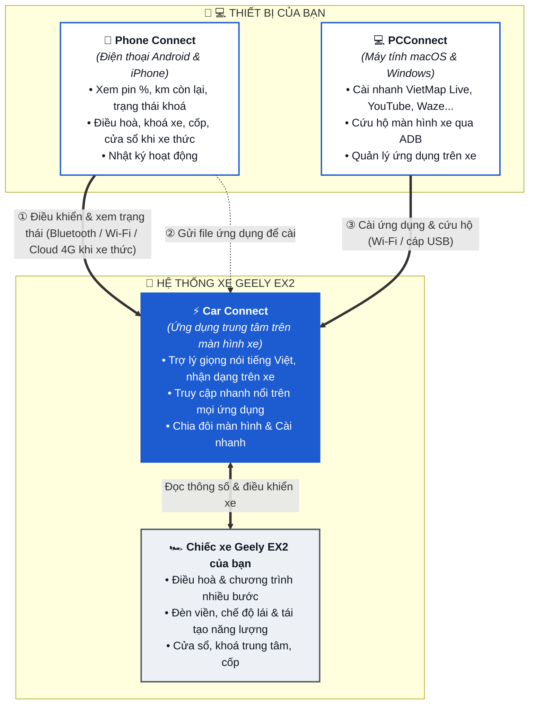

### 📋 Các cách kết nối & sử dụng

| Kênh kết nối | Phương thức | Mục đích sử dụng |
|---|---|---|
| **Điều khiển & giám sát xe** | `Bluetooth` · `Wi-Fi` · `Cloud 4G` | Xem pin %, km còn lại, chỉnh điều hoà, khoá xe, mở cốp, đóng/mở kính từ điện thoại khi xe đang bật (ACC / nổ máy). |
| **Cài ứng dụng từ điện thoại** | `Wi-Fi nội bộ` | Gửi file ứng dụng từ điện thoại lên màn hình xe để cài ngay. |
| **Cài ứng dụng & cứu hộ từ máy tính** | `Wi-Fi` · `Cáp USB` | Cài ứng dụng trọn gói (VietMap Live, YouTube, Spotify...), cứu hộ màn hình và quản lý ứng dụng. |

---

## 🛡️ Thao tác bị chặn khi xe đang chạy

Lệnh bấm tay và lệnh giọng nói **không hỏi xác nhận chỉ vì xe đang chạy**. Xe chỉ hỏi lại khi **nghe chưa rõ** câu lệnh.
Một số thao tác vẫn bị chặn khi xe đang chạy, và app báo lý do bằng tiếng Việt:

| Thao tác | Khi nào bị chặn |
|---|---|
| **Mở cốp trước / mở khoá cốp sau** | Khi xe đang chạy |
| **Cảnh nghỉ trưa** | Khi xe đang chạy |
| **Cốp sau điện, gập gương** *(chỉ xe có lắp, bật trong Cài đặt)* | Khi xe đang chạy |
| **Chia đôi màn hình** | Khi hệ thống cửa sổ của xe chưa sẵn sàng (không phụ thuộc tốc độ) |
| **Điều khiển từ điện thoại khi xe ngủ sâu** | Đầu xe đã ngắt điện — mở ACC hoặc nổ máy để nhận lệnh |

---

## 🔒 Cam kết an toàn — không can thiệp hệ thống gốc

- 🛡️ **KHÔNG đụng phân vùng `/system`**: không root, không remount, không ghi đè file nào của hệ điều hành xe.
- 🚗 **KHÔNG can thiệp ECU chuyên sâu**: app chỉ dùng cổng API tiêu chuẩn của Android Automotive (VHAL) để đọc thông số
  (pin %, tốc độ, nhiệt độ) và điều khiển tiện nghi (điều hoà, kính, đèn viền, âm lượng).
- 🔄 **Gỡ là sạch**: app chạy như một app Android thông thường. Khi không muốn dùng nữa, **gỡ app (Uninstall)** là xe về
  trạng thái như lúc chưa cài.

---

## 🛠 Cách cài

- **Lên xe (Car Connect):** dùng PCConnect trên máy tính (mục Cài nhanh / Cài app) cài `CarConnect.apk`.
- **Lên điện thoại Android (Phone Connect):** tải `PhoneConnect.apk`, cho phép cài từ nguồn không rõ (Cài đặt → Bảo mật), cài như APK thường.
  Mở app → **Cài đặt → Kết nối** chọn Bluetooth / Wi-Fi / Cloud 4G, hoặc bấm **Quét tìm xe**.
- **Trên máy tính (PCConnect):** tải `.dmg` (Mac) hoặc `.exe` (Windows) → mở app → trình duyệt tự mở `http://localhost:8848` → dùng được ngay; muốn thêm tính năng thì **kích hoạt mã**.

---

## 🔑 Kích hoạt mở thêm gì?

**Bộ app này không miễn phí — cần mã kích hoạt.** Mã do quản trị viên cấp, kích hoạt bằng
**mã + số điện thoại** (1 mã = 1 người, 1 máy mặc định). Xin mã trong
[nhóm Zalo](https://zalo.me/g/knl7dndglibpuzclc4vg).

Riêng PCConnect cho dùng trước phần cài app cho xe / quản lý file khi chưa kích hoạt;
kích hoạt sẽ mở thêm:
- **Công cụ thiết bị** — công cụ quản trị chuyên sâu trên xe
- **Mục VietMap Live** trong Cài nhanh
- **Hệ thống đồng bộ giấy phép nâng cao**

---

## 📣 Báo lỗi / góp ý

- Vào nhóm Zalo để trao đổi, báo lỗi, góp ý trực tiếp: **[zalo.me/g/knl7dndglibpuzclc4vg](https://zalo.me/g/knl7dndglibpuzclc4vg)**
- Khi báo lỗi, kèm theo: đang chạy bản nào, thao tác gì thì lỗi, ảnh chụp màn hình (nếu chụp được).
